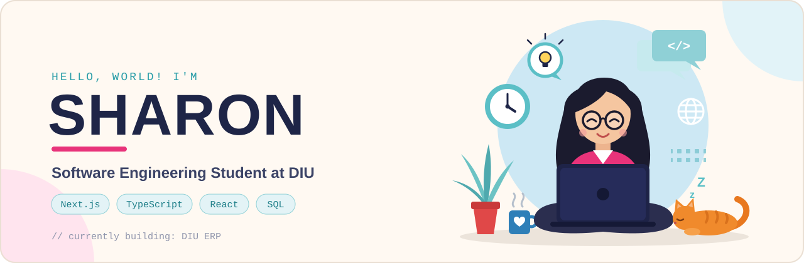

<h2 align="left">Hi! I'm Sharon 👋 I write the code, the cat does the code review.</h2>

  

<h3 align="center">Software Engineering Student at Daffodil International University · Building DIU ERP</h3>

- 🔭 I'm currently working on [DIU ERP, a university ERP system](https://github.com/adilsay3d22/diuerp01)

  

- 👩‍💻 All of my projects are available at [github.com/mohubits?tab=repositories](https://github.com/mohubits?tab=repositories)

- 📫 How to reach me **mohuamonjurisharon@gmail.com**

 

  

